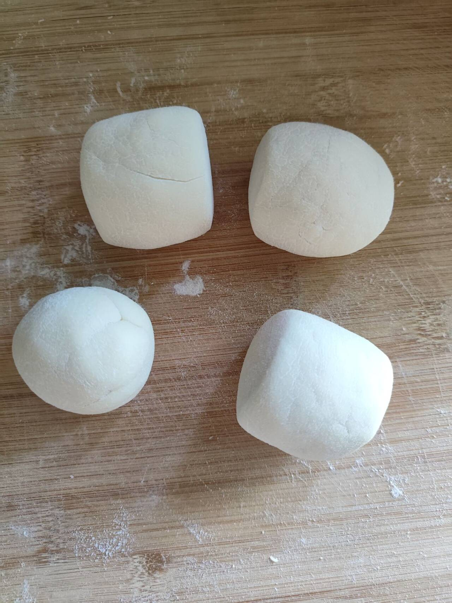

# 做馒头-第一百一十八期

自从我姐在我这里做成了肉包子，自己也想动手来做馒头了，自己做出来的东西就是异常好吃，而且自己动手做美食，既消磨时间，又可以吃到健康的食物，真的很好，下次自己买面粉自己做。

## 技术类分享

### 2026年JavaScript最新动态

[https://blog.master.dev/what-to-know-in-javascript-2026-edition/](https://blog.master.dev/what-to-know-in-javascript-2026-edition/)

CodePen 和 CSS-Tricks 创始人克里斯·科耶（Chris Coyier）的文章，介绍 JS 技术栈各方面（语法、运行时、框架、工具等）的最新进展，推荐阅读。

永恒的答案是：学习这些技术的基本原理，无论工具、框架等等如何变化，都将使你受益匪浅。而且，恕我直言，人工智能在代码编写方面发挥的作用越大，我们就越需要像你这样真正了解自己在做什么的人，能够帮助我们规划、指导、完善、测试、架构代码，并赋予代码良好的设计理念，无论代码是如何创建的。

### C语言的灵活真函数大小不是设计失误

[https://pikuma.com/blog/c-integer-sizes-not-a-mistake](https://pikuma.com/blog/c-integer-sizes-not-a-mistake)

一篇 C 语言科普文章，解释为什么它的数据类型的字节大小是可变的，比如 int 类型可以是4个字节，也可以是两个字节。

### 如何让AI网页看起来像设计师的作品

[https://railcode.dev/blog/vibe-coded-website](https://railcode.dev/blog/vibe-coded-website)

作者介绍他怎么让 AI 生成的网页（上图），看起来像真人设计的。

### 给导弹写代码，为什么严谨使用动态内存分配

[https://mp.weixin.qq.com/s/RL8w75YfXQrRubSLJHnSVA](https://mp.weixin.qq.com/s/RL8w75YfXQrRubSLJHnSVA)

洛克希德·马丁公司的军工武器 C 语言编码规则，有一条字数很短，但语气重得吓人：严禁使用 malloc、free、new 和 delete 等动态操作内存的命令。这是为什么？

## 非技术类分享

### 继续享受编程仍然没问题

[https://chriskiehl.com/article/it-is-still-ok-to-enjoy-programming](https://chriskiehl.com/article/it-is-still-ok-to-enjoy-programming)

尽管 AI 改变了编程的经济学，但享受编程本身仍然完全正当。他周末自己手写游戏代码、学习依赖类型和递归方案，并非为了实用价值，而是因为解决问题和理解困难概念本身就令人快乐。文章呼吁大家不要被互联网上的悲观情绪感染，享受事物不需要经济理由来证明。

### 艺术历史步行之旅

[https://artmuseum.artfrompixels.com/](https://artmuseum.artfrompixels.com/)

这个网站将维基百科上面的画作，按照艺术流派，变成可以步行参观的 3D 画廊。

### stillwet

[https://stillwet.art/](https://stillwet.art/)

这个网站提供 AI 生成的油画，它模仿人类的油画笔触，一笔笔绘制，非常逼真，根本看不出这是 AI 的作品。

### 灯泡计算机

[https://lightbulbcomputer.com/](https://lightbulbcomputer.com/)

未来的计算机变成灯泡的形状，可以投影成各个地方，只通过手指进行操控，感觉有点难以实现，不过如果真的实现了，那就是未来了。
