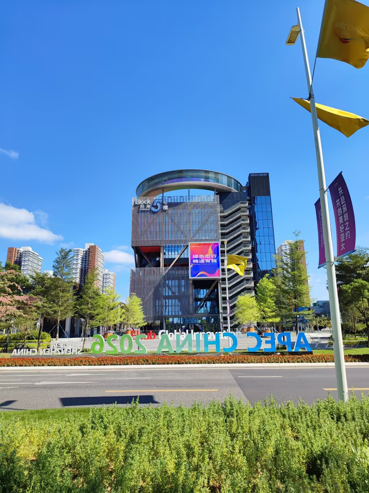

# 蓝天-第一百二十期

终于在深圳看到了特别蓝的天空，夏天的时候一直灰蒙蒙的有雾霾一样，现在看到这样透亮的天气，心情不自觉就很好，即将到来的APEC会议，现在深圳环境好很多。

## 技术类分享

### Lemmings CSS Animation

[https://markblah.github.io/lemmings/](https://markblah.github.io/lemmings/)

一个纯前端互动实验项目，用 CSS 精灵动画和实时指针物理引擎重现了经典游戏《旅鼠》。用户可以生成、拖拽、弹射像素小人，动态调整浏览器窗口大小会让角色随布局变化被弹飞。项目利用 CSS 变换卸载渲染到合成器线程，在 60-120 FPS 下保持流畅，展示了浏览器原生空间画布的创意潜力。

### H.264视频压缩编码

[https://sidbala.com/h-264-is-magic/](https://sidbala.com/h-264-is-magic/)

这篇2016年的经典技术文章从高层次讲解了H.264视频压缩编码的核心原理。未压缩的1080p 60fps视频每秒约370MB，而H.264通过有损压缩、信息熵编码、频域变换、帧间预测和运动补偿等多重技术，将数据量压缩到极小。文章用Apple主页截图演示了同一画面下PNG截图(1015KB)对比H.264五秒视频(175KB)的惊人压缩效率，生动地展示了30多年视频压缩技术积累的成果。

### Declarative Dragging-声明式拖拽

[https://declarative-dragging.github.io/](https://declarative-dragging.github.io/)

这是 UIST 2026 最佳论文，提出了"声明式拖拽"的新范式。开发者无需编写复杂的拖放交互代码，只需声明拖拽元素可以到达哪些未来状态，系统会自动推测渲染这些状态并合成流畅的拖放交互。该方法是模型驱动和可组合的，已实现为名为 Dragology 的 SVG 库，适用于教育、游戏设计、数学可视化等场景，大幅降低了构建高质量拖放界面的门槛。

## 非技术类分享

### 什么是硬币钱包

[https://decrypt.co/resources/what-is-a-hardware-wallet-crypto-cold-storage-explained](https://decrypt.co/resources/what-is-a-hardware-wallet-crypto-cold-storage-explained)

一种专用物理设备（通常 U 盘或卡片大小），离线生成和存储加密货币私钥。币本身仍在链上，钱包只保存"证明你拥有它"的密钥。属于"冷存储"，与浏览器插件/手机 App 等"热钱包"相对。 但这种也不绝对安全，还是出现了金额较大的安全事故。

### 数学已经变了，让我们假装变了

[https://terrytao.wordpress.com/2026/11/01/mathematics-has-changed-lets-act-like-it/](https://terrytao.wordpress.com/2026/11/01/mathematics-has-changed-lets-act-like-it/)

陶哲轩博客发表的 Frank Calegari 客座文章，回应 OpenAI 于 10 月发布 700+ 篇数学研究论文对数学界的冲击。文章以有限单群分类的历史为类比，论证即使 AI 声称解决了某领域所有公开问题，也不意味着学科已"完结"，而是开启新探索的起点。呼吁数学家不必悲观，应像 Gorenstein 整理分类证明那样，主动梳理和验证 AI 成果。

### 为什么眯着眼睛能看的更清楚

[https://www.mentalfloss.com/science/why-does-squinting-help-you-see-better](https://www.mentalfloss.com/science/why-does-squinting-help-you-see-better)

你可能以为，这跟眼睛的压力有关，眯眼"挤压眼球"，暂时重塑晶状体的焦距，使其更好地聚焦。这种想法是不对的。

眯眼的真正作用在于减少进入眼睛的光线量。通过眯眼，人们实际上让眼睛变小，减少多余光线的干扰，只允许光线进入靠近视野中心的位置，从而使视网膜上的光线更加集中。这称为针孔效应，这才是看得更清晰的根本原因。

眯眼对眼睛不利的方面，主要是眯眼后，眨眼的次数会减少。因此，长时间眯眼（例如，整天眯着眼睛看电脑屏幕）会导致眼睛疲劳或干眼症。

与某些观点相反，眯眼不会损害你的视力。它不是视力下降的原因，而是视力下降的症状。如果你不分场合一直在眯眼，那么你需要检查视力。

### 我知道数学家为何哭泣

[https://www.derekthompson.org/p/i-know-why-the-mathematicians-weep](https://www.derekthompson.org/p/i-know-why-the-mathematicians-weep)

过去几个月，OpenAI 公司发布了 AI 做出的数百项数学证明。这震惊了数学界，一位数学家说他不禁哭了，感到 AI 毁灭了自己的研究领域。

技术乐观主义者可能不会这样想，他会劝这位数学家振作起来。

数学不会在意你的感受，科学现实对你的眼泪漠不关心。你感到自己的圣殿被毁灭了，可是这种事以前也发生在别人身上。接受现实吧。

### 英伟达创始人兼CEO黄仁勋向全体员工发送内部信

[https://nvidianews.nvidia.com/news/a-message-to-our-company](https://nvidianews.nvidia.com/news/a-message-to-our-company)

英伟达创始人兼CEO黄仁勋向全体员工发送内部信，承认自己对妻子不忠，为此向家人和公司全体员工道歉。他表示对自己的行为承担全部责任，强调没有任何借口，并对伤害了家人深感抱歉。信中承诺将继续领导公司，同时修复与家人的关系。此事引发了董事会对其行为的调查。

撇开对这件事和公众舆论的看法不谈，我不得不说，这是我很久以来第一次看到一位商人以公司名义写道歉信，真正承认错误并承担责任。通常他们的道歉更像是虚假的道歉，比如“我很抱歉你有这种感觉”，或者在这个特殊情况下，我想他们会说类似这样的话：“我很抱歉我被监视了，我已经尽力了，但我没有任何准备去对付外国特工。”看到“我的职责是为您服务，不辜负您的信任。我未能履行这一职责。我将全力以赴留在英伟达，努力重新赢得您的信任。”这样的话语，令人耳目一新。
